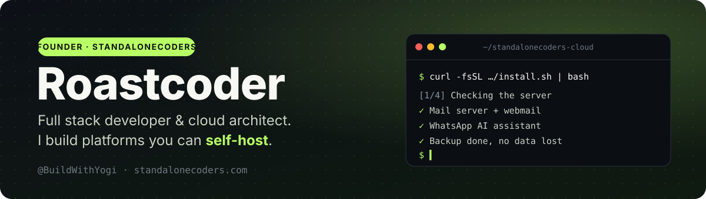
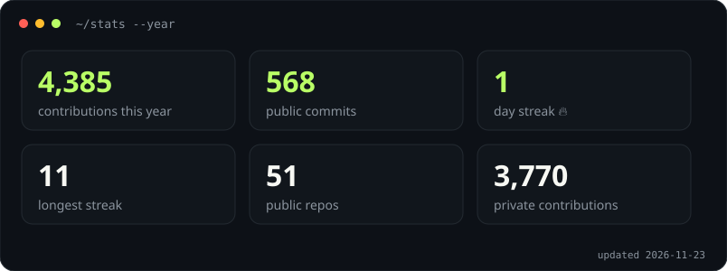
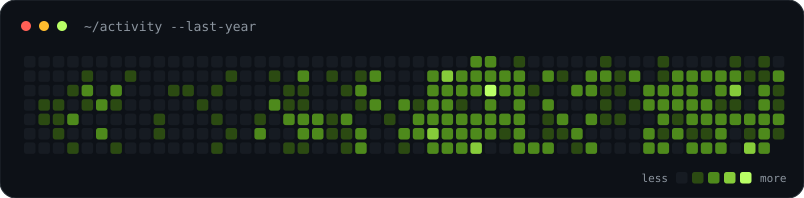
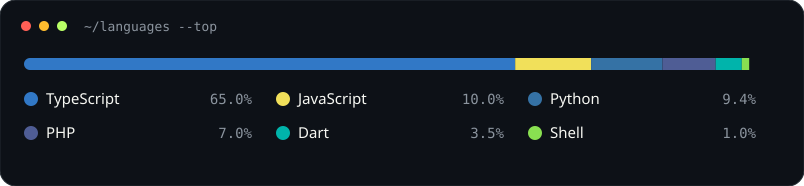

<a href="https://standalonecoders.com"></a>

<p align="center">
  <a href="https://standalonecoders.com"></a>
  <a href="https://standalonecoders.com/cloud"></a>
  <a href="mailto:yogendra6378@gmail.com"></a>
  
</p>

<table>
<tr>
<td width="58%" valign="top">

### 👋 Hey, I'm Roastcoder

I run **[StandaloneCoders](https://standalonecoders.com)**, a small studio that builds web products and the servers they run on. I like owning the whole stack: the database schema, the API, the UI, and the Linux box underneath.

Right now I'm building a self-hosted cloud platform, and an automotive credit platform.

</td>
<td width="42%" valign="top">

### ⚡ Right now

- 🛠️ Shipping **StandaloneCoders Cloud**
- 🚗 Building **Car Credit Hub**
- 📚 Learning Kubernetes at scale
- 💬 Ask me about Laravel, React, Docker, Linux
- 🍔 Faster at race conditions than at lunch

</td>
</tr>
</table>

## ☁️ StandaloneCoders Cloud

<a href="https://standalonecoders.com/cloud"></a>

A self-hosted deploy platform built on Coolify: apps, databases **and email** on servers you own.

| | | |
|:--|:--|:--|
| 📬 **Free mail server**<br/><sub>Your domains, DKIM/SPF/DMARC, Outlook-style webmail</sub> | 🤖 **WhatsApp AI assistant**<br/><sub>Restart or redeploy from chat, on a local model</sub> | 🔄 **Safe updates**<br/><sub>Backup first, live progress, no data lost</sub> |
| 🔐 **SMS sign-in codes**<br/><sub>One-time code after your password</sub> | 🧑‍💻 **VS Code in the browser**<br/><sub>Edit any app straight from the panel</sub> | 🩹 **Server patching**<br/><sub>OS updates in the background with a progress bar</sub> |

**One command, no token:**

```bash
curl -fsSL https://raw.githubusercontent.com/Roastcoder/standalonecoders-cloud-install/main/install.sh | sudo bash
```

<p>
  <a href="https://github.com/Roastcoder/standalonecoders-cloud-install"></a>
  <a href="https://standalonecoders.com/cloud"></a>
</p>

## 🚗 Car Credit Hub

A car-loan platform for a lending business, from the first application to the payout.

| | | |
|:--|:--|:--|
| 📝 **Loan pipeline**<br/><sub>Applications, documents and approvals in one flow</sub> | 🧑‍💼 **A desk for every role**<br/><sub>Sales, RBM, insurance, accounts, PDD and admins each see their own work</sub> | 💸 **Payments & vouchers**<br/><sub>Approvals, vouchers, UTR and proof of payment, tracked end to end</sub> |
| 💬 **WhatsApp bot**<br/><sub>Each person gets a menu for their role and a "waiting for me" queue</sub> | 📊 **Live summaries**<br/><sub>Dashboards and per-role counts on web and WhatsApp</sub> | 🔒 **Role-based access**<br/><sub>Sensitive data only for the roles that need it</sub> |

## 🧰 Toolbox

<p>
  
</p>

## 📊 This year on GitHub





<sub>Cards are drawn by <a href="./scripts/stats.py">scripts/stats.py</a> and refreshed every morning by a GitHub Action.</sub>
